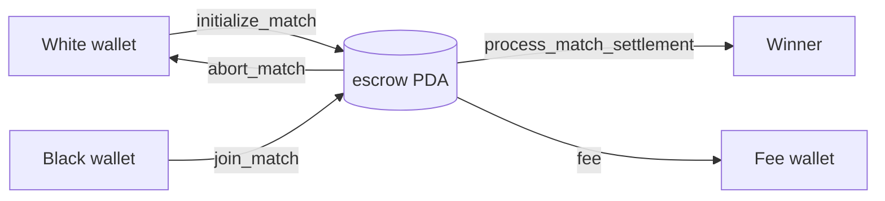

# Wagers and settlement

Every match has a wager, which can be zero. The program keeps it in an escrow
token account owned by a PDA, and only the program can move it.

## Terms set at creation

| Term | Set by | Notes |
| --- | --- | --- |
| Token mint | Creator | Any SPL Token mint. ZUG Arena defaults to WSOL |
| Amount per player | Creator | Raw token units. `0` = free match |
| Per-move time limit | Creator | Seconds. ZUG Arena offers 60, 180 and 600 |
| Platform fee | Creator | Basis points, max 10 000. ZUG Arena uses 100 (1%) |
| Fee wallet | Creator | Receives the fee. Settlement checks the fee token account is owned by it |
| Start time | Creator | Now, in 10 minutes, or a chosen date and time. Carried in the match id, see below |

The joiner must deposit exactly the same amount of the same mint
(`BetAmountMismatch` / `InvalidMintForJoin` otherwise).

## Start time and the join window

The program lets anyone join an open match as soon as it exists; it has no
start time. ZUG Arena schedules a match without a program change by writing
the planned start into the match id, which every reader gets from the chain:

| Match id | Meaning |
| --- | --- |
| `mc-<16 hex>` | Starts now |
| `mc-<16 hex>-t<base36>` | Starts at `<base36>` minutes since the Unix epoch |
| `mc-<20 hex>` | Older ids, start now |

The SDK's `buildMatchId({ startsAt })`, `scheduledStartAt(matchId)` and
`matchStartState(matchId, createdAt)` build and read these ids. The backend
returns the same facts as `startsAt`, `openUntil`, `scheduled` and
`startPhase` on `/api/matches`.

An open match takes a joiner for **60 minutes** after its start time
(`OPEN_MATCH_WINDOW_SECONDS`). Before the start the lobby shows "Starts …" and
the play page counts down with the join button disabled. After the window the
lobby hides the match from everyone but its creator, and the play page tells
the creator nobody joined and offers **Cancel and get refund** (`abort_match`,
which returns the stake and the escrow rent).

The app enforces this window; the chain does not yet. A raw SDK call can still
join early or late. Enforcing it on-chain (a `starts_at` and a join deadline
on `ChessMatch`, with a permissionless `abort_match` after the deadline so a
keeper can refund abandoned matches) is planned for the next account-layout
change.

## Escrow flow

## Outcomes

| Result | Payout |
| --- | --- |
| White or Black wins | Winner receives `total_pot - fee` |
| Draw | `total_pot - fee` split: White gets half rounded down, Black the rest |
| Aborted before join | Creator refunded in full, no fee |
| Free match | Nothing moves; settlement records the result and closes the escrow |

`fee = total_pot × fee_bps / 10 000`, integer division.

## Who can settle

`process_match_settlement` is permissionless. Anyone can call it once the match
is finished and back on L1, because every account is checked against the
match: player token accounts must belong to the players, all must use the match
mint, and no account can appear twice. Settlement runs once
(`PayoutAlreadyProcessed`) and closes the escrow account. Its rent goes to
`payer`, which the program pins to a player or the platform fee wallet; the
sponsored app flow names the platform wallet, so rent the sponsor paid comes
back to the house.

After settlement, `close_match` closes the `ChessMatch` account and returns
its rent.

## Today vs planned

Players currently press **Collect the pot** (winner) or **Save result and pay
out** in the app, which runs `undelegate_match` on the rollup and then
`process_match_settlement` on L1.
Automating this is on the [Roadmap](../roadmap.md).
